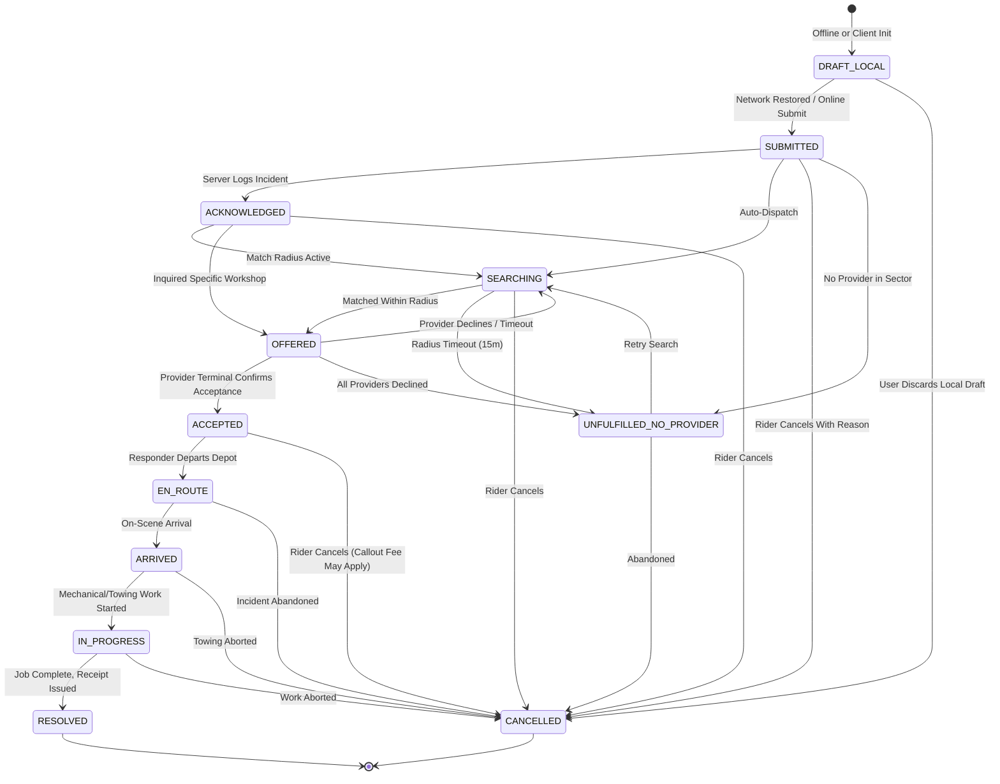

# MotoAssist — Automotive Incident & Safety Hazard Register

**Product:** MotoAssist Connected Vehicle & Motorcycle Roadside Response  
**Standard Baseline:** Risk-based engineering inspired by ISO 26262 safety principles (Safety-critical web response architecture; no formal ISO certification claimed)  
**Version:** 6.0-Automotive  
**Audit Date:** 2026-10-16  

---

## Safety Hazard Assessment Matrix

| ID | Hazard | Trigger / Root Cause | Potential Severity & Impact | Preventive Control | Recovery / Fallback | Verification Test | Responsible Component | Release Status |
|---|---|---|---|---|---|---|---|---|
| **HAZ-01** | **Wrong or Stale Emergency Location** | GPS permission denied, mobile cached stale coordinates, or GPS jitter in mountain canyon. | **Catastrophic (ASIL-D candidate)**: Responders dispatched to wrong highway sector; critical delay in trauma care. | Timestamped GPS validation; explicit location provenance classification (`GPS_FRESH`, `GPS_STALE`, `MANUAL_LANDMARK`, `UNAVAILABLE`); accuracy radius checked. Never hardcode Siliguri/NH10 fallback. | 1-tap landmark picker (Sevoke, Coronation Bridge, Sukna, etc.); address input; copyable raw coordinates for voice readout to 112. | `client/src/tests/emergencyFlow.test.ts` (Location provenance test) | `client/src/hooks/useUserLocation.ts`, `AssistanceRequest.ts` | **PASS (Gated)** |
| **HAZ-02** | **Failed SOS Submission** | Cellular packet data drop, server crash, or 500 error during emergency request. | **Critical**: Rider stranded in remote area believing help was dispatched when it failed silently. | Transparent server acknowledgement confirmation; direct `tel:112` cellular calling link displayed prominently without network dependency. | `DRAFT_LOCAL` offline queue; clear UI banner stating request was NOT sent and cellular voice line must be used. | `server/src/tests/api.test.ts`, `client/src/utils/offlineQueue.ts` | `client/src/utils/offlineQueue.ts`, `server/src/controllers/assistanceController.ts` | **PASS (Gated)** |
| **HAZ-03** | **Duplicate Requests / Fleet Flooding** | Rider repeatedly tapping SOS/Request button during high-latency network retries. | **Moderate**: Multiple tow trucks dispatched to same scene; operator confusion and resource exhaustion. | Standard HTTP `Idempotency-Key` header and backend unique index replay. Duplicate submits return original incident record with HTTP 200 `idempotentReplay: true`. | Client debounces submit buttons with loading spinner; operator queue identifies matching coordinates within 5 minutes. | `server/src/tests/api.test.ts` (Idempotency replay test) | `server/src/controllers/assistanceController.ts`, `mockStore.ts` | **PASS (Gated)** |
| **HAZ-04** | **False Crash Detection Alert** | Phone dropped, pothole impact, or synthetic sensor noise triggering automated dispatch. | **High**: False 112 calls or panicked emergency contacts when rider is uninjured. | Continuous background sensor crash detection prohibited on web platform without dedicated hardware/telematics OBD-II gateway. No simulated automatic accelerometer triggers. | Manual SOS requires 3-second deliberate hold; 10-second audio cancellation countdown window before contact notification. | `client/src/tests/smartEntryAndVerification.test.ts` | `client/src/pages/SOSPage.tsx` | **PASS (Gated)** |
| **HAZ-05** | **Provider Fails to Arrive / No-Show** | Mechanic vehicle breakdown, landslide road closure, or provider unresponsiveness. | **Critical**: Injured or stranded rider left waiting in night conditions with no backup. | Mandatory provider acceptance before displaying assignment; real-time telemetry freshness tracking; 15-minute inactivity threshold in operations queue. | Operator escalation queue (`/ops`) triggers re-search or `UNFULFILLED_NO_PROVIDER` fallback with direct 112 police referral. | `server/src/tests/api.test.ts` (Ops queue delayed cases) | `server/src/controllers/assistanceController.ts`, `client/src/pages/OperationsQueuePage.tsx` | **PASS (Gated)** |
| **HAZ-06** | **Misleading / Fake Dispatch Claims** | UI claiming ambulance/police dispatched when no formal computer-aided dispatch (CAD) integration exists. | **Catastrophic**: Rider delays calling real emergency services believing government dispatch is already en route. | Strict Truthful State Machine: distinguish `DRAFT_LOCAL`, `SUBMITTED`, `ACKNOWLEDGED`, `SEARCHING`, `OFFERED`, `ACCEPTED`, `EN_ROUTE`. Never claim direct ERSS-112 CAD dispatch. | Prominent native `tel:112` and `tel:108` phone links with explicit label: "Direct Emergency Voice Call". | `client/src/tests/emergencyFlow.test.ts`, `ActiveIncidentHUD.tsx` | `client/src/components/ActiveIncidentHUD.tsx`, `RequestDetailsPage.tsx` | **PASS (Gated)** |
| **HAZ-07** | **Unavailable Network / Cellular Dead Zone** | Complete signal loss in mountain ravines (e.g. Teesta gorge or Sukna forest). | **High**: Inability to load web app or submit incident over HTTP/WebSocket. | Service Worker PWA offline caching of static assets and Remote Readiness emergency card; local caching of verified 24/7 mountain corridor safety stops. | Offline queue marks status as `DRAFT_LOCAL` with warning banner; offline guide with exact physical coordinates and phone numbers for emergency calling. | `client/src/tests/emergencyFlow.test.ts`, `offlineQueue.test.ts` | `client/src/pages/RemoteReadinessPage.tsx`, `offlineQueue.ts` | **PASS (Gated)** |
| **HAZ-08** | **Unavailable Contact Channel** | Trusted family contact has phone off or rider's SIM card has depleted SMS pack. | **Moderate**: Family unaware of rider distress. | Multi-channel dispatch options: WhatsApp link with pre-filled GPS coordinates, native SMS fallback, direct voice phone call. | Manual WhatsApp URL generator with copyable emergency text; 112 universal line as primary safety net. | `client/src/utils/whatsappShare.ts` | `client/src/pages/EmergencyAssistPage.tsx` | **PASS (Gated)** |
| **HAZ-09** | **Unauthorized Incident Access / IDOR** | Malicious actor guessing sequential incident IDs to track rider location or tamper with status. | **Critical**: Stalking risk, physical safety compromise of vulnerable or stranded rider. | High-entropy non-sequential incident IDs (`REQ-` + cryptographically random hex/base36); JWT bearer token authentication; role-based access control. | Server validates `riderId` or authenticated helper ownership before returning live coordinates. | `server/src/tests/verification.test.ts`, `api.test.ts` | `server/src/controllers/assistanceController.ts`, `middleware/auth.ts` | **PASS (Gated)** |
| **HAZ-10** | **Exposure of Identity / Medical Information** | Leaking blood group, allergies, or driving license document keys in unauthenticated endpoints or local storage. | **High**: Identity theft, HIPAA/GDPR privacy violation, medical data exposure. | Masked identity display (`DL-WB74-****`); client-side file size (<5MB) and type validation; zero caching of raw identity documents in client localStorage. | Medical ID view restricted to explicit user consent or dedicated emergency QR code. | `client/src/tests/smartEntryAndVerification.test.ts` | `client/src/services/verificationApi.ts`, `server/src/controllers/verificationController.ts` | **PASS (Gated)** |

---

## State Transition Integrity Verification

---

## Operational Verification Sign-Off

- [x] **Zero Fabricated ERSS-112 CAD Integration**: Explicit distinction between native cellular `tel:112` and system dispatch.
- [x] **Zero Fabricated Provider Acceptance**: `ActiveIncidentHUD` and `RequestDetailsPage` only display provider cards once backend registers status `ACCEPTED`.
- [x] **Zero Hardcoded Siliguri Fallbacks**: Stale or missing GPS labeled truthfully as `MANUAL_LANDMARK` or `UNAVAILABLE`.
- [x] **Automotive State Machine**: Illegal transitions rejected with HTTP 409 Conflict.
- [x] **Idempotency Protection**: Repeated network attempts with same key prevent duplicate dispatches.
- [x] **Remote Area Resilience**: PWA offline emergency card download and 24/7 mountain corridor registry active.
